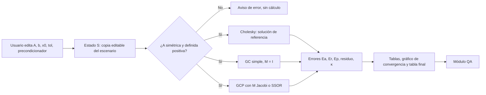

 Gradientes Conjugados Precondicionado (GCP) aplicado al presupuesto de un proyecto de software
 
**Universitario:** Josué David Monasterios Calizaya
**Materia:** Métodos Numéricos
**Carrera:** Informática, Facultad de Ciencias Puras y Naturales, Universidad Mayor de San Andrés (UMSA)
**Mención:** Desarrollo de Sistemas
**Modalidad:** Individual
 
**Página web pública:** `PEGAR_AQUI_EL_ENLACE_PUBLICO`
**Repositorio:** `PEGAR_AQUI_EL_ENLACE_DEL_REPOSITORIO`
 
---
 
## 1. Descripción
 
Aplicación web interactiva del desafío académico "Aplicación del Método de Gradientes Conjugados Precondicionado en problemas financieros". Modela el reajuste del presupuesto de un proyecto de software en cuatro categorías como un sistema lineal simétrico definido positivo `Ax = b` y lo resuelve con tres métodos:
 
1. **Método directo (Cholesky):** solución numérica de referencia.
2. **Gradientes Conjugados Precondicionado (GCP):** algoritmo de Suñagua (2020).
3. **Gradientes Conjugados simple (GC):** solo como contraste de velocidad.
Todo se recalcula en el navegador al editar los datos. No hay servidor ni informe aparte: la fundamentación, los resultados y las pruebas están dentro de la página.
 
## 2. Caso financiero
 
Una empresa de software reparte un presupuesto (en miles de USD) entre cuatro categorías que comparten recursos. El reparto óptimo minimiza el costo cuadrático:
 
```
f(x) = 1/2 xᵀAx − bᵀx      →      Ax = b
```
 
| Variable | Significado |
|---|---|
| x₁ | Desarrollo (backend y frontend) |
| x₂ | Pruebas y QA |
| x₃ | Infraestructura cloud |
| x₄ | Seguridad y DevOps |
 
- `aᵢᵢ`: peso de costo propio de la categoría i.
- `aᵢⱼ = aⱼᵢ`: acoplamiento por recursos compartidos entre las categorías i y j. Esto hace que A sea simétrica.
- `bᵢ`: demanda presupuestaria objetivo de la categoría i.
Los datos son un modelo ilustrativo construido para el desafío, no datos reales de una empresa.
 
## 3. Los tres escenarios
 
| Escenario | Modificación | Qué se espera |
|---|---|---|
| **Ideal** | `A` tridiagonal bien escalada, `b = [20, 15, 12, 8]` | κ(A) bajo, convergencia rápida |
| **Bajo estrés** | Inflación del 20 % en `b` y `a₂₂` pasa de 5 a 6 (más exigencia de QA) | Se desplaza la solución sin cambiar mucho el condicionamiento |
| **Mal condicionado** | `A = D·B·D` con `D = diag(1, 10, 100, 30)` y `b` escalado | κ(A) alto por mal escalamiento diagonal; el precondicionador de Jacobi lo corrige |
 
Las tres comparten las mismas variables y la misma estructura.
 
## 4. Qué implementa la página
 
| Sección | Contenido |
|---|---|
| Encabezado | Datos del estudiante, mención y resumen |
| 1. Caso de estudio y formulación | Variables, sistema `Ax = b`, interpretación de coeficientes |
| 2. Entrada de datos y escenarios | Edición de `A`, `b`, `x₀`, tolerancia, iteraciones máximas y precondicionador (Jacobi o SSOR); botones de carga de escenarios |
| 3. Verificación y resultados | Simetría, menores de Sylvester y autovalores; solución de referencia, GCP y GC; iteraciones; residuo relativo; κ(A) y κ(M⁻¹A); errores absoluto, relativo y porcentual por variable; gráfico de convergencia |
| 4. Módulo QA | Tabla de pruebas con Entrada, Resultado esperado, Resultado obtenido y Conclusión |
| 5. Tabla comparativa final | Soluciones de Cholesky, GCP y GC simple para los tres escenarios |
| 6. Conclusiones y referencias | Interpretación técnica y financiera, y bibliografía |
 
### Algoritmo GCP (Suñagua, 2020)
 
```
r0 = b − A·x0
resolver M·z0 = r0 ;  p0 = z0
para k = 0, 1, 2, ...
    αk   = (rkᵀ zk) / (pkᵀ A pk)
    xk+1 = xk + αk pk
    rk+1 = rk − αk A pk
    resolver M·zk+1 = rk+1
    βk   = (rk+1ᵀ zk+1) / (rkᵀ zk)
    pk+1 = zk+1 + βk pk
parar cuando ‖rk‖₂ / ‖b‖₂ < tolerancia (por defecto 10⁻⁶) o k = Nmáx
```
 
El GC simple es el mismo algoritmo con `M = I`.
 
### Precondicionadores
 
- **Jacobi:** `M = diag(A)`. Es el recomendado para mal escalamiento diagonal.
- **SSOR (ω = 1):** `M = (D + L) D⁻¹ (D + Lᵀ)`. Útil si hay acoplamiento fuerte fuera de la diagonal.
### Errores y condicionamiento
 
- Error absoluto `Ea,i = |x_ref,i − x_GCP,i|`.
- Error relativo `Er,i = Ea,i / |x_ref,i|`. Si `x_ref,i = 0` se indica "no definido".
- Error porcentual `Ep,i = Er,i · 100 %`.
- Residuo relativo global `‖b − A·x_GCP‖₂ / ‖b‖₂`.
- `κ(A) = λmax / λmin` (autovalores por el método de Jacobi para matrices simétricas).
- `κ(M⁻¹A)` se calcula con los autovalores de `L⁻¹ A L⁻ᵀ`, donde `M = L Lᵀ`.
## 5. Pruebas de software (módulo QA)
 
| N.º | Prueba | Criterio de éxito |
|---|---|---|
| 1 | Carga de escenarios | Los tres convergen y el GCP coincide con la referencia |
| 2 | Matriz no válida | Se detecta una matriz no simétrica y otra simétrica no definida positiva, con aviso y sin colapsar |
| 3 | Edición dinámica | Al cambiar coeficientes cambian la referencia y el GCP, con residuo menor que la tolerancia |
| 4 | Comparación de precondicionamiento | En el escenario mal condicionado, iteraciones GCP ≤ iteraciones GC |
 
Las pruebas se ejecutan al cargar la página y con el botón **Ejecutar pruebas**.
 
## 6. Arquitectura
 
Es una aplicación de **un solo archivo** (`index.html`) con HTML, CSS y JavaScript puro. No usa librerías ni dependencias externas.
 
```
.
├── index.html     # interfaz, estilos y toda la lógica numérica
└── README.md
```
 
Dentro de `index.html` el código se organiza en capas:
 
| Capa | Funciones principales |
|---|---|
| Datos | Objeto `SC` con los tres escenarios; copia de trabajo `S` editable |
| Álgebra lineal | `mv`, `mm`, `chol`, `fs`/`bs`/`cs` (sustituciones y resolución con Cholesky), `det`, `eig` |
| Métodos numéricos | `cg` (GC y GCP), `precM` (construcción de `M`), `analyze` (verificaciones, referencia, errores, κ) |
| Interfaz | `buildInp`, `render`, `chart`, `final`, `load` |
| Pruebas | `runQA` |
 
Flujo: un evento `input` en la tabla de entrada actualiza `S`, y `render()` llama a `analyze()` y redibuja resultados, gráfico y tabla final. Si `analyze()` detecta una matriz no válida, devuelve un error que se muestra al usuario y no se ejecuta ningún método.
 
### Diagrama de arquitectura
 

 
## 7. Instalación y ejecución local
 
### Requisitos
 
- Un navegador moderno (Chrome, Edge, Firefox o Safari).
- Git, solo si vas a clonar el repositorio.
- Opcional: Python 3 o Node.js para levantar un servidor local. No son necesarios para usar la aplicación.
La aplicación no tiene dependencias: no hay `npm install` ni `pip install`.
 
### Paso 1. Obtener el código
 
```bash
git clone PEGAR_AQUI_EL_ENLACE_DEL_REPOSITORIO
cd nombre-del-repositorio
```
 
También puedes descargar el ZIP desde GitHub (**Code → Download ZIP**) y descomprimirlo.
 
### Paso 2. Ejecutar (elige una opción)
 
| Opción | Comando o acción |
|---|---|
| A. Directo | Doble clic en `index.html` |
| B. Python | `python3 -m http.server 8000` y abrir `http://localhost:8000` |
| C. Node.js | `npx serve .` y abrir la dirección que indique |
| D. VS Code | Instalar la extensión *Live Server*, clic derecho en `index.html`, **Open with Live Server** |
 
### Paso 3. Verificar que funciona
 
1. La sección 3 debe mostrar "A es simétrica y definida positiva" y las tablas de resultados.
2. En la sección 4, las cuatro pruebas deben aparecer como **Aprobada**.
3. Pulsa **Mal condicionado**: las iteraciones del GCP deben ser menores o iguales a las del GC simple.
### Problemas frecuentes
 
- **La página sale en blanco:** abre la consola del navegador (F12) y revisa errores; usa una opción de la tabla anterior.
- **No aparecen resultados:** puede que hayas dejado una matriz no válida; el aviso rojo indica cuál es el problema.
- **Un valor no cambia al escribir:** usa punto o coma decimal y no dejes el campo vacío.
## 8. Publicación (GitHub Pages)
 
1. Sube `index.html` y `README.md` a la rama `main`.
2. En el repositorio entra a **Settings → Pages**.
3. En **Source** elige `Deploy from a branch`, rama `main` y carpeta `/ (root)`.
4. El enlace público queda como `https://TU_USUARIO.github.io/NOMBRE_REPO/`.
## 9. Estructura del repositorio e historial de commits
 
El repositorio debe ser público, con esta estructura y un historial de commits que muestre el avance:
 
```
.
├── index.html     # aplicación completa
└── README.md      # este archivo
```
 
Secuencia sugerida de commits:
 
```bash
git init
git add index.html && git commit -m "Estructura base y estilos de la página"
git add index.html && git commit -m "Álgebra lineal: Cholesky, autovalores y verificación SPD"
git add index.html && git commit -m "Implementación de GC y GCP con Jacobi y SSOR"
git add index.html && git commit -m "Análisis de errores, condicionamiento y gráfico"
git add index.html && git commit -m "Módulo QA y tabla comparativa final"
git add README.md && git commit -m "README con instalación, arquitectura y ejecución"
git branch -M main
git remote add origin PEGAR_AQUI_EL_ENLACE_DEL_REPOSITORIO
git push -u origin main
```
 
Cada commit debe contener un cambio real; evita subir todo en un solo commit.
 
## 10. Limitaciones
 
- El sistema es de tamaño fijo n = 4 (el desafío exige n ≥ 4).
- No se implementó el precondicionador de Cholesky incompleto (IC0); se ofrecen Jacobi y SSOR.
- Los datos del caso son ilustrativos.
## 11. Referencias
 
- Suñagua S., P. (2020). *Método de Gradientes Conjugados Precondicionado*. Revista Boliviana de Matemática, UMSA, 04, 2–7.
- Golub, G. H., y Van Loan, C. F. (2013). *Matrix Computations* (4.ª ed.). Johns Hopkins University Press.
- Saad, Y. (2003). *Iterative Methods for Sparse Linear Systems* (2.ª ed.). SIAM.
 
